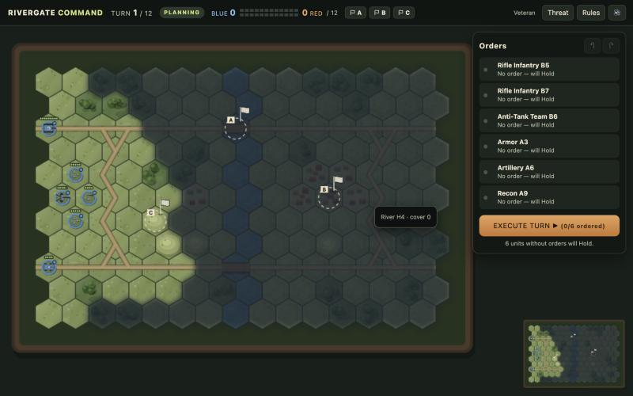
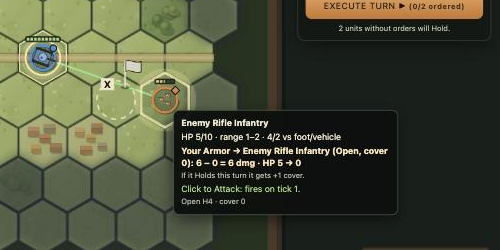
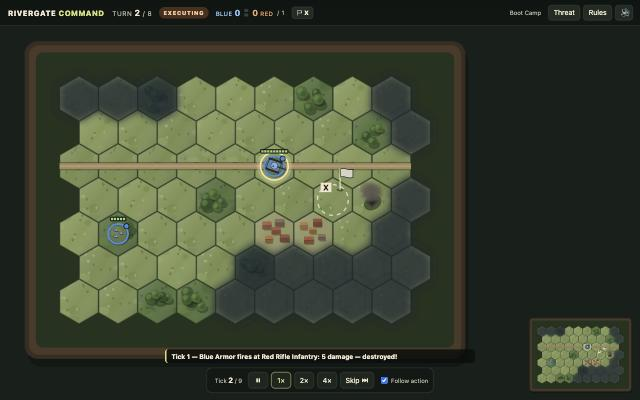
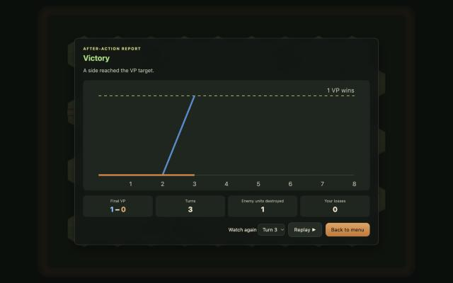

# TacticSim: Rivergate Command

A deterministic **WEGO tactical simulation** (both sides plan at the same time, then the battle
plays out tick by tick) with a C# authoritative engine and a Phaser/TypeScript canvas client.
Fictional setting, original art, no dice: every preview is exact.

[Game design spec](docs/v2/GAME_DESIGN_AND_ROADMAP.md) · [Design decisions](docs/v2/decisions.md) ·
[Balance log](docs/v2/balance-log.md) · [Release checklist](docs/release-checklist.md)



## How it plays

1. **Plan.** Give each unit one order: Move, Attack (move then fire), Hold (+1 cover),
   Overwatch (fire at the first enemy that comes into range) or Barrage (artillery shell lands on
   tick 6). The enemy plans at the same moment and you can't see its orders.
2. **Execute.** All orders resolve together over 8 ticks. Watch it, pause it, speed it up, skip it,
   or replay it.
3. **Score.** Each objective you control at the end of the turn gives +1 VP. First to 12 VP wins,
   or destroy every enemy, or lead after turn 12.

Fog of war is enforced on the server: you see only what your units see, and enemies that slip back
into the fog stay on the map as faded "last seen" markers. Damage is
`attack (vs Foot or vs Vehicle) − cover`, minimum 1.

| Combat preview | Execution | After-action report |
|---|---|---|
|  |  |  |

New players start with **Boot Camp**: three guided turns (move, read the preview and attack, take
the objective). The **Rules** screen has eight short cards and the full tables.

## Architecture

```
content/v1/*.json          rules, terrain, units, maps: every balance number lives here
src/TacticSim.Sim          pure C#: hex math, Dijkstra with tick costs, LOS/fog, order validation,
                           TurnResolver (8 ticks), scoring, fog-filtered views, utility AI
src/TacticSim.Web          ASP.NET Core: /api/v2, PostgreSQL (EF Core), /play page, Classic v1 pages
client/                    Vite + TypeScript + Phaser 4 + DOM HUD -> src/TacticSim.Web/wwwroot/game
tools/TacticSim.Balance    AI-vs-AI balance runner
src/TacticSim.Core         v1 engine, unchanged so old saves still load
```

- **The server is the authority.** The client mirrors pathfinding, LOS and damage only for previews,
  and must pass golden vectors exported by the C# tests (`client/test/vectors`).
- **Deterministic.** Everything iterates in unit-id order; the AI's only randomness is a seed saved
  with the match. A test re-runs saved orders from the scenario and must reproduce every snapshot.
- **Never leaks hidden info.** State and replays are filtered per side; the AI plans from the same
  filtered view a player gets, so it can't cheat.
- **Safe saves.** Each turn (both order sets, the tick log and the end snapshot) commits in one
  transaction. Idempotent command ids, version checks (409), owner cookie, antiforgery header.
  Rules content is versioned and pinned per match. Migrations are additive.

## Run locally

Needs the .NET 10 SDK, Node 24 and PostgreSQL (development defaults to the `/tmp` socket, database
`tacticsim`, your OS user).

```sh
cd client && npm ci && npm run build && cd ..      # builds the game into wwwroot/game
dotnet build TacticSim.sln
dotnet run --project src/TacticSim.Web -- --migrate --environment Development   # additive migrations
dotnet run --project src/TacticSim.Web --launch-profile http                    # http://localhost:5178/play
```

`npm run dev` (from `client/`) serves the client on Vite with `/api` proxied to the .NET server.

## Checks

```sh
dotnet build TacticSim.sln -c Release --warnaserror
dotnet test TacticSim.sln -c Release        # engine, AI, PostgreSQL/HTTP tests; refreshes golden vectors
cd client && npm run typecheck && npm test  # TypeScript mirror vs the C# golden vectors
dotnet run --project tools/TacticSim.Balance -c Release -- --games 500 --blue Veteran --red Veteran
```

Persistence tests create and drop uniquely named schemas; point `TACTICSIM_TEST_CONNECTION` at a
dedicated test database, never production. Current counts: 106 engine/AI tests (97.5% line
coverage on `TacticSim.Sim`), 36 PostgreSQL/HTTP tests, 87 Classic v1 tests, 10 client tests.

## Classic (v1)

The original 8×8 "Operation Rivergate" game still runs at `/` with its history at `/History`, and
its saves load unchanged. See [rules](docs/rules.md) and [architecture](docs/architecture.md).

## Deployment

The established host is free Render (Docker) with Prisma PostgreSQL; see
[the deployment guide](docs/deployment.md). The Dockerfile now builds the client in a Node stage
before `dotnet publish`. **v2 is not deployed yet**: deploying needs a verified production backup,
then the additive `V2Simulation` migration, then a live check of `/health`, a full match and an
old v1 save.

## Honest limits

- One scenario plus Boot Camp; single player against the server AI; no accounts or multiplayer.
- The simulation is a readable game model, not a realistic military model.
- The AI is a utility scorer with a short look-ahead (Commander), not a deep search.
