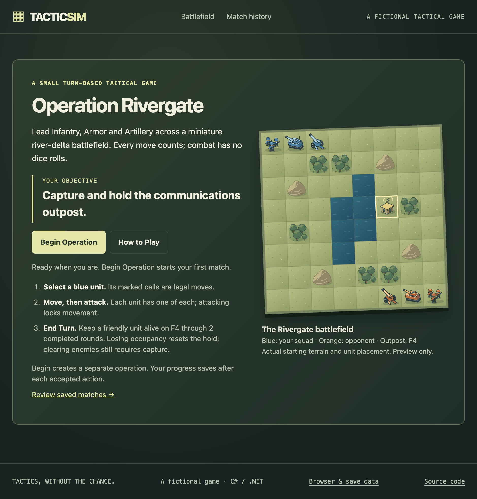
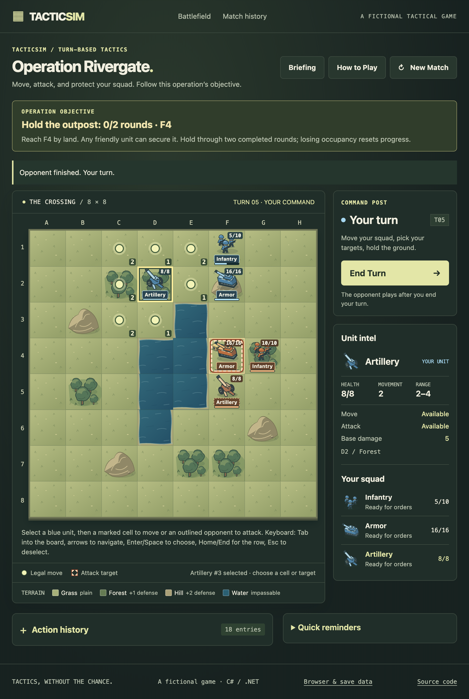
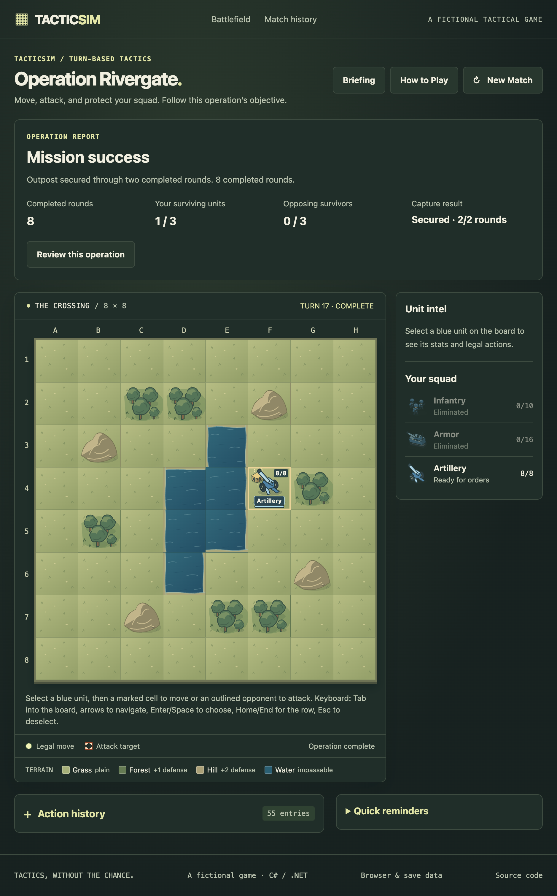

# TacticSim: Operation Rivergate

A small fictional turn-based tactical game built as a C#/.NET portfolio project.
Lead a blue squad of Infantry, Armor and Artillery against a deterministic orange
opponent. Reach the communications outpost at F4 and keep a friendly unit alive
there through two completed human-plus-computer rounds. Losing occupancy resets
the hold; losing the squad means defeat. Clearing every opponent still requires
finishing capture.

[Play the hosted game](https://tacticsim.onrender.com/) · [Game rules](docs/rules.md) ·
[Release/deployment evidence](docs/release-checklist.md) · [60-second demo and CV text](docs/portfolio.md)

The free host may take about a minute to wake. The release checklist records the
actual deployed revision; a pushed commit or green CI alone is not a deployment.

## Implemented experience

- One illustrated 8×8 battlefield with original local SVG Infantry, Armor,
  Artillery, grass, forest, hills, connected water and a communications outpost.
- Select, move, attack and End Turn. Four-direction Dijkstra movement accounts
  for terrain costs, water and living occupants. Manhattan attack range includes
  artillery's minimum range; damage is deterministic with terrain defense.
- Server-validated legal-action highlights, remaining actions, health, capture
  progress, contextual errors, an optional action-driven tutorial and reusable help.
- Brief route/combat/health effects and ordered opponent actions from structured
  server frames. Skip/Escape and reduced motion immediately show the saved board.
- Automatic PostgreSQL saves, anonymous browser ownership, owned history/review/
  resume and mission reports showing actual rounds, survivors and capture result.
- Antiforgery-protected commands, optimistic versions, atomic events/receipts and
  idempotent retries. Refresh, replayed network responses and old tabs cannot
  grant extra actions. Legacy matches retain their elimination objective.
- Responsive controls, keyboard board navigation, explicit empty/loading/offline
  states and a factual browser-data notice. Action history is a log, not a replay.

## Screenshots

Actual Chrome captures of the implemented Release 5 application running locally;
not design mockups. Screenshot provenance is in [screenshots/README](docs/screenshots/README.md).







## Actual stack

.NET 10 / C#, ASP.NET Core Razor Pages, EF Core 10 with Npgsql/PostgreSQL,
plain JavaScript/CSS and original SVG, xUnit and GitHub Actions. Docker runs the
web app on free Render; Prisma Postgres hosts PostgreSQL. There is no frontend
framework, npm dependency, Node build pipeline or Prisma ORM. Optional JavaScript
regression tests use Node's built-in test runner only.

## Run locally

Install the .NET 10 SDK and PostgreSQL. From this directory:

```sh
dotnet restore TacticSim.sln
dotnet build TacticSim.sln --configuration Release --no-restore
# Only if the local database does not already exist:
createdb tacticsim
dotnet tool restore --tool-manifest dotnet-tools.json
dotnet ef database update --project src/TacticSim.Web --configuration Release -- --environment Development
dotnet run --project src/TacticSim.Web --launch-profile http
```

Open http://localhost:5178/. Begin Operation is the only first-visit creation
step; opening the briefing, preview, help or history never starts a match.
Development on macOS/Linux defaults to PostgreSQL on `/tmp`, database `tacticsim`,
using your OS username. The matching role/database must exist. For another setup,
use `ConnectionStrings__DefaultConnection` or .NET user secrets. Keep credentials
outside Git. Production requires an explicit PostgreSQL connection and HTTPS.
Apply EF migrations; do not use `EnsureCreated` or reseed an existing database.

## Checks

```sh
dotnet build TacticSim.sln --configuration Release --no-restore --warnaserror
dotnet test TacticSim.sln --configuration Release --no-build --no-restore
node --test scripts/tutorial.test.cjs scripts/presentation.test.cjs
# With the web application running:
python3 scripts/verify_web.py http://localhost:5178
python3 scripts/verify_mission.py http://localhost:5178
python3 scripts/verify_usability.py http://localhost:5178
```

Core tests need no database. Persistence tests require PostgreSQL and create/drop
only uniquely named test schemas; configure `TACTICSIM_TEST_CONNECTION` for a
**dedicated test database**, never production. At Release 5 the suite contains
87 engine and 25 PostgreSQL tests plus 16 JavaScript checks. CI also verifies EF
model/migrations, publish, a non-root 512 MB production Docker container behind
TLS, ownership/CSRF/races, full capture/defeat and container replacement.

## Architecture and persistence

`TacticSim.Core` owns domain models, abstract Unit subclasses and all game rules.
It has no EF, web or database dependencies. `TacticSim.Web` reconstructs Core
state, accepts protected intent, serves Razor Pages and persists relational
matches, units, ordered events, command receipts and browser-session selection.
The browser displays server choices and frames; it never calculates legal routes
or damage. Reports derive from saved state rather than invented counters.

Each accepted command and its events commit atomically. Session and match
versions reject stale commands; an owner-scoped receipt makes retries safe.
Data Protection keys persist in PostgreSQL so the protected owner cookie remains
usable across deployments. Old snapshot tables remain migration backups; legacy
saves/receipts remain compatible. See [architecture](docs/architecture.md).

## Deploy the existing application

Follow [the deployment guide](docs/deployment.md). The repository includes a
multi-stage .NET 10 Dockerfile and free Render configuration. Runtime uses
`ConnectionStrings__DefaultConnection`; optional direct
`ConnectionStrings__MigrationConnection` is used only by the migration process.
Provider secrets stay outside Git. The versioned start script applies reviewed
migrations before serving on the provider's PORT. Production proxy HTTPS and
PostgreSQL-backed cookie keys are already configured for the established host.

Before a schema change, back up and rehearse restoration/migration in a separate
database. Retain matches, legacy backups and keys. Deploy a green-CI commit
manually, compare `/health` revision, then check gameplay, history/resume and an
existing cookie/save. Release 5 introduces no schema migration. No production
database files belong in the web container.

## Honest limits

- One fixed mission/map, six starting units, no multiplayer, login, fog of war,
  random combat or external AI. The opponent is a bounded deterministic greedy
  strategy, not sophisticated AI or a multi-turn planner.
- This is a fictional game, not a claim of real-world military simulation accuracy.
  Terrain and units do not block attack line of sight. Complete rounds are
  distinguished from an elimination that ends during an incomplete round.
- Saves belong to the anonymous browser cookie (normally up to 30 days). Clearing
  cookies, closing a private session or changing browsers can lose access.
  There is no cross-device account recovery, replay feature or offline gameplay.
- Free hosting can cold-start and has provider usage limits. PostgreSQL data/key
  backups require operational care; a demonstration deployment is not an SLA.
- Mobile checks use Chrome emulation unless the verification record explicitly
  says otherwise. No physical-device or exhaustive screen-reader audit is claimed.
- See [verification](docs/verification.md) for observed checks, access blockers
  and the exact deployed source. No following release is implied.
